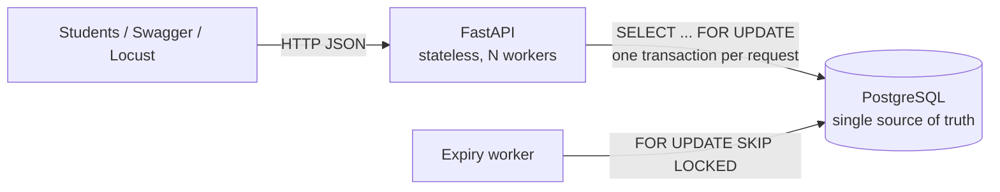
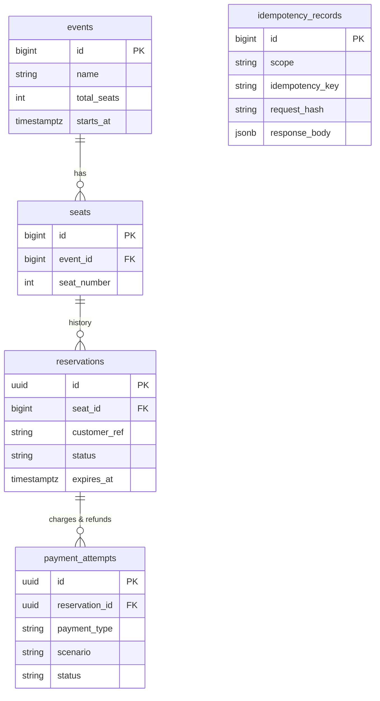
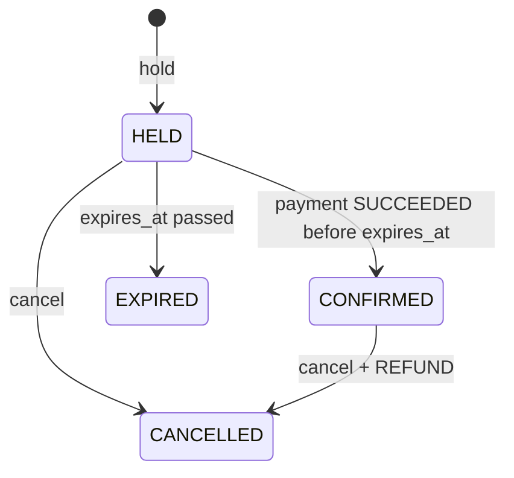

# The Last Seat 

**Concurrency-safe ticket booking backend.** CodeChef-VIT Promotional Cycle 2026–27, Backend Development task.

> A college concert has **500 seats** and **10,000 students** trying to book at 6 PM. Payments fail, students abandon carts, and many try to grab the same seat at once. This backend lets students hold a seat temporarily, pay, cancel, and see their history, and it guarantees that **no seat is ever booked twice**.

Stack: Python 3.12 · FastAPI · SQLAlchemy 2 (sync) · PostgreSQL 18 · psycopg 3 · Alembic · Pydantic v2 · Pytest · Locust · Docker Compose.

---

## Highlights (all measured, see [TEST_REPORT.md](TEST_REPORT.md))

* **100 students, 1 seat, one instant:** exactly **1 × `201`**, **99 × `409`**, **0 × `5xx`**, and exactly 1 active row in PostgreSQL.
* **73/73 tests pass** against real PostgreSQL: 24 unit, 40 integration, 9 multi-threaded concurrency.
* **Load test:** 150 users for 60 s on a laptop gave **26,524 requests, ~447 RPS, p50 9 ms, p95 30 ms, p99 74 ms, 0 failures**, and all database invariants held afterwards ([report](reports/load_test_report.md)).
* Holds **expire automatically**: lazily under the seat lock, and proactively by a `SKIP LOCKED` worker.
* Simulated payments **SUCCESS / FAILURE / DELAYED (+ webhook callback)**. A late callback after expiry is **voided** and never re-books a seat.
* **Idempotency-Key** on every POST, stored in PostgreSQL, so double-clicks and retries are safe.

## How double booking is made impossible

```
BEGIN
  SELECT ... FROM seats WHERE event_id=:e AND seat_number=:n FOR UPDATE   -- 1. per-seat mutex
  SELECT clock_timestamp()                                                -- 2. real "now", after the wait
  UPDATE reservations SET status='EXPIRED' WHERE seat_id=:s AND status='HELD' AND expires_at <= :now   -- 3. lazy expiry
  SELECT ... FROM reservations WHERE seat_id=:s AND status IN ('HELD','CONFIRMED')                     -- 4. still taken? -> 409
  INSERT INTO reservations (... 'HELD', expires_at = :now + TTL)          -- 5. hold
COMMIT
```

plus, at the storage level:

```sql
CREATE UNIQUE INDEX uq_reservations_one_active_per_seat
ON reservations (seat_id) WHERE status IN ('HELD', 'CONFIRMED');
```

Full specification, lock ordering, and the ten invariants: [docs/concurrency_design.md](docs/concurrency_design.md).

## Architecture



More detail: [architecture](docs/architecture.md) · [ERD](docs/erd.md) · [sequence diagrams for all 6 workflows](docs/booking_workflow.md) · [database design](docs/database_design.md) · [scaling](docs/scaling.md).

## Data model



`seats` has **no `is_available` column**. Availability is derived from live reservations, so it can never drift out of sync.

### Reservation state machine



Payment attempts: `PENDING → SUCCEEDED | FAILED | VOIDED`. Rows are never deleted.

## API

Interactive docs: **http://127.0.0.1:8000/docs**. Full guide with captured responses: [docs/api_guide.md](docs/api_guide.md).

| Method & path | Purpose | Codes | Idempotency-Key |
|---|---|---|---|
| `GET /health/live`, `GET /health/ready` | liveness / DB readiness | 200, 503 | — |
| `GET /api/v1/events` | events with live counts | 200 | — |
| `GET /api/v1/events/{event_id}` | one event + summary | 200, 404 | — |
| `GET /api/v1/events/{event_id}/seats?available_only=true` | derived availability | 200, 404 | — |
| `GET /api/v1/events/{event_id}/seats/{seat_number}` | one seat | 200, 404 | — |
| `POST /api/v1/reservations` | hold a seat | 201, 404, 409, 422 | ✅ |
| `GET /api/v1/reservations/{id}` | status, expiry, payments | 200, 404 | — |
| `POST /api/v1/reservations/{id}/confirm` | pay: `SUCCESS` / `FAILURE` / `DELAYED` | 200, 202, 402, 404, 409 | ✅ |
| `POST /api/v1/reservations/{id}/cancel` | cancel (refund if paid), free the seat | 200, 404, 409 | ✅ |
| `GET /api/v1/payments/{id}` | one payment attempt | 200, 404 | — |
| `POST /api/v1/payments/{id}/simulate-callback` | finish a DELAYED payment | 200, 404, 409 | ✅ |
| `GET /api/v1/customers/{customer_ref}/bookings` | booking history | 200 | — |

Errors always look like:

```json
{ "error": { "code": "SEAT_UNAVAILABLE", "message": "Seat 42 for this event is currently held or confirmed by another user.", "details": { "seat_status": "HELD" } } }
```

### Example requests (PowerShell)

```powershell
$B = "http://127.0.0.1:8000"
$body = @{ event_id = 1; seat_number = 42; customer_ref = "22BCE1234" } | ConvertTo-Json
$hold = irm "$B/api/v1/reservations" -Method Post -ContentType "application/json" -Body $body -Headers @{ "Idempotency-Key" = [guid]::NewGuid().ToString() }
$rid  = $hold.reservation.id                     # status HELD, expires_at = now + 300 s
irm "$B/api/v1/reservations/$rid/confirm" -Method Post -ContentType "application/json" -Body '{"scenario":"SUCCESS"}'
irm "$B/api/v1/customers/22BCE1234/bookings"
irm "$B/api/v1/reservations/$rid/cancel" -Method Post   # refund recorded, seat free again
```

---

## Workflow A: local PostgreSQL (default, Windows PowerShell)

Uses **your existing PostgreSQL server** on `localhost:5432` and only the dedicated databases `last_seat_db` and `last_seat_test_db`. Nothing else on your server is touched.

```powershell
# 1. Python environment
py -3.12 -m venv .venv
.\.venv\Scripts\python.exe -m pip install -r requirements-dev.txt

# 2. Config: copy the template and choose a password for the project role
Copy-Item .env.example .env
notepad .env        # replace both CHANGE_ME with the same new password

# 3. One-time DB bootstrap (asks for YOUR postgres superuser password inside psql).
#    Creates role last_seat_app + last_seat_db + last_seat_test_db only if missing; drops nothing.
powershell -ExecutionPolicy Bypass -File .\scripts\bootstrap_local_db.ps1

# 4. Schema + demo data (500-seat concert, event id 1). Both are safe to re-run.
.\.venv\Scripts\alembic.exe upgrade head
.\.venv\Scripts\python.exe scripts\seed_demo_data.py

# 5. Run the API (terminal 1) and the expiry worker (terminal 2)
.\.venv\Scripts\uvicorn.exe app.main:app --host 127.0.0.1 --port 8000
.\.venv\Scripts\python.exe -m app.cli worker

# 6. Open http://127.0.0.1:8000/docs
```

Useful commands:

```powershell
.\.venv\Scripts\python.exe -m app.cli db-check      # which DB / role / server version
.\.venv\Scripts\python.exe -m app.cli invariants    # SQL invariant checks (exit 1 on violation)
$env:HOLD_TTL_SECONDS = "30"                        # short holds for a live demo (before starting uvicorn)
```

## Workflow B: Docker Compose (reproducible, isolated)

A completely separate stack: its own PostgreSQL container on **host port 5433** with a named volume, so it never collides with your local server on 5432.

```powershell
docker compose up --build -d          # db -> migrate (wait, alembic, seed) -> api + worker
docker compose ps
docker compose logs -f api worker
irm http://127.0.0.1:8000/health/ready
docker compose down                   # stop; data stays in volume last_seat_pgdata
```

* The container DB password defaults to a throwaway value; override it with `$env:POSTGRES_PASSWORD = "..."` before the first `up`.
* If your local API already uses port 8000: `$env:API_HOST_PORT = "8001"`.
* `docker compose down -v` **deletes** the container database volume. Use it only when you really want a fresh container DB.

> **Verified 2026-10-17** (Docker Desktop 29.7.2): build ✓, `migrate` applied the schema and seeded 500 seats and exited 0 ✓, `api` healthy and running as non-root `appuser` ✓, worker expiring holds ✓, full `scripts/demo.py --late` against the containers ✓, a 30 s / 80-user Locust run gave 7,459 requests at 249 RPS with 0 failures and all invariants 0 ✓, graceful `SIGTERM` stop ✓. Your local PostgreSQL was untouched. Details: [TEST_REPORT.md](TEST_REPORT.md#docker-compose-workflow-b).

## Testing

```powershell
.\.venv\Scripts\python.exe -m pytest                 # everything (≈65 s)
.\.venv\Scripts\python.exe -m pytest tests/unit      # no database needed
.\.venv\Scripts\python.exe -m pytest tests/concurrency -s   # prints status-code histograms
.\.venv\Scripts\ruff.exe check . ; .\.venv\Scripts\ruff.exe format --check .
```

Safety: `tests/conftest.py` aborts unless `TEST_DATABASE_URL` points at **`last_seat_test_db`**. The cleanup fixture also asks the server `SELECT current_database()` before truncating the three mutable tables of that test database.

## Load testing

```powershell
.\.venv\Scripts\python.exe -m app.cli seed --event-id 2 --name "Load test" --seats 500   # separate event; demo concert untouched
$env:LOCUST_EVENT_ID = "2"
.\.venv\Scripts\locust.exe -f locust/locustfile.py --headless -u 150 -r 25 -t 60s --host http://127.0.0.1:8000
.\.venv\Scripts\python.exe -m app.cli invariants
```

Use a new `--event-id` for each run, so no cleanup is ever needed. Results: [reports/load_test_report.md](reports/load_test_report.md).

## Live review demo

```powershell
$env:HOLD_TTL_SECONDS = "20"; .\.venv\Scripts\uvicorn.exe app.main:app --port 8000     # terminal 1
powershell -ExecutionPolicy Bypass -File .\scripts\demo.ps1 -Seat 77 -Late              # terminal 2
```

It runs a 100-student stampede, a failed payment and retry, a delayed payment with callback, cancellation with refund and reallocation, an idempotent double-click, and a late callback being voided. See also [docs/review_questions.md](docs/review_questions.md).

## Security assumptions (demo scope)

* **No authentication.** `customer_ref` is a caller-supplied demo identifier (e.g. a registration number). Reservation and payment UUIDs are random v4 and effectively act as unguessable capability tokens. A production system would add JWT or OAuth and per-user hold limits.
* Secrets live only in `.env` (gitignored). The app connects as a non-superuser role that owns only the project databases.
* Errors never expose stack traces or connection strings. Unexpected errors return `500 INTERNAL_ERROR` and roll back.
* All input is validated by Pydantic (`extra="forbid"`, bounded lengths, restricted `customer_ref` charset); all SQL is parameterised.
* Payments are simulated; no card data exists anywhere.

## Scaling roadmap

The API is stateless, so you scale it by adding replicas; PostgreSQL enforces every guarantee. Next steps, in order: PgBouncer (connections), a virtual waiting room for the 6 PM spike, best-available allocation with `SKIP LOCKED`, short-TTL caching of seat maps (never of booking decisions), then a reverse proxy and deployment. Trade-offs of Redis, Kafka/RabbitMQ, and queues: [docs/scaling.md](docs/scaling.md).

## Repository map

```
app/            FastAPI app: routes, schemas, services (transactions + locking), models, worker
migrations/     Alembic (hand-written initial migration with all constraints & partial indexes)
scripts/        bootstrap_local_db.ps1/.sql, seed_demo_data.py, wait_for_database.py, demo.ps1/.py
tests/          unit / integration / concurrency (real PostgreSQL, real HTTP, threads)
locust/         load-test scenarios
docs/           architecture, ERD, workflows, concurrency design, DB design, API guide,
                learning guide, scaling, troubleshooting, review Q&A
reports/        load-test report + raw Locust/pytest artifacts
```

Project docs: [DECISIONS.md](DECISIONS.md) (reflection drafts) · [TEST_REPORT.md](TEST_REPORT.md) · [PROJECT_STATUS.md](PROJECT_STATUS.md) · [docs/learning_guide.md](docs/learning_guide.md).
