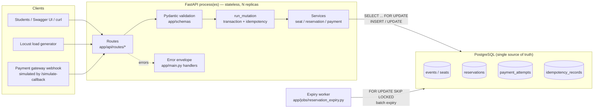

# Architecture

## Request lifecycle (POST /api/v1/reservations)

1. **Uvicorn** receives the HTTP request and hands it to FastAPI.
2. FastAPI parses JSON into `ReservationCreate` (Pydantic). Bad input → `422 VALIDATION_ERROR` before any DB work.
3. `Depends(get_db)` opens a `Session` (borrows a pooled connection). `Depends(idempotency_key)` reads the optional header.
4. The route calls `run_mutation(...)`, which owns the transaction: idempotency lock → service → store response → `COMMIT` (or `ROLLBACK` on unexpected errors).
5. The service (`reservation_service.create_reservation`) runs the locking algorithm and returns `(201, body)` or raises a `DomainError` (409/404).
6. The session is closed in `get_db`'s `finally`; the connection returns to the pool.

## Who owns what

| Concern | Owner | Why there |
|---|---|---|
| HTTP shape, status codes, headers | `app/api/routes/*` | thin; no business logic |
| Transaction boundaries & idempotency | `app/services/idempotency_service.run_mutation` | one place to audit BEGIN/COMMIT/ROLLBACK |
| Business rules & lock order | `app/services/*_service.py` | testable without HTTP; never commit themselves |
| Integrity guarantees | PostgreSQL constraints | survives any application bug |
| Expiry housekeeping | `app/jobs/reservation_expiry.py` (separate process) | API latency unaffected; optional for correctness |
| Config | `app/core/config.py` (`.env` / env vars) | 12-factor; DB-target guard lives here |

## Why the API is stateless

Nothing about reservations, payments or idempotency is kept in Python memory: no caches, no global dicts, no in-process locks. Consequences:

* any number of API processes/containers can run behind a load balancer;
* a crash or restart loses nothing (`test_restart_loses_no_state`);
* the concurrency guarantees hold across processes because the locks live in PostgreSQL.

## Processes in each workflow

| Workflow A (local) | Workflow B (Docker Compose) |
|---|---|
| your PostgreSQL 18 on `localhost:5432` | container `db` (postgres:18-alpine), host port `5433`, volume `last_seat_pgdata` |
| `uvicorn app.main:app` in `.venv` | container `api` (2 uvicorn workers), host port `8000` |
| `python -m app.cli worker` | container `worker` |
| `alembic upgrade head` + seed by hand | one-shot container `migrate` (wait → migrate → seed) |
