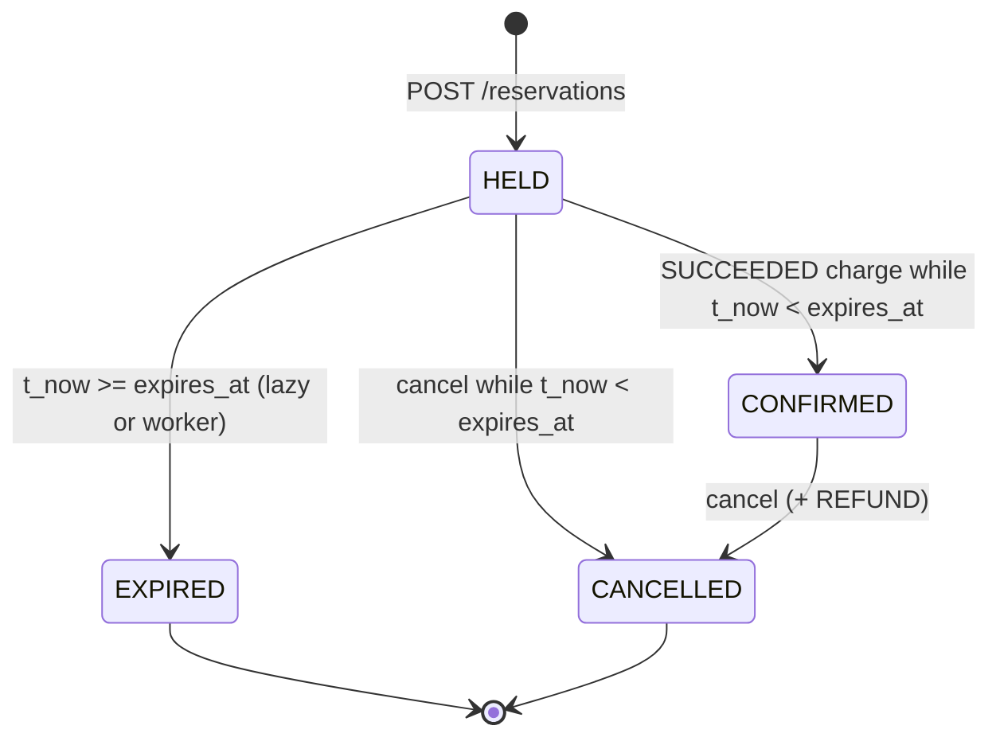
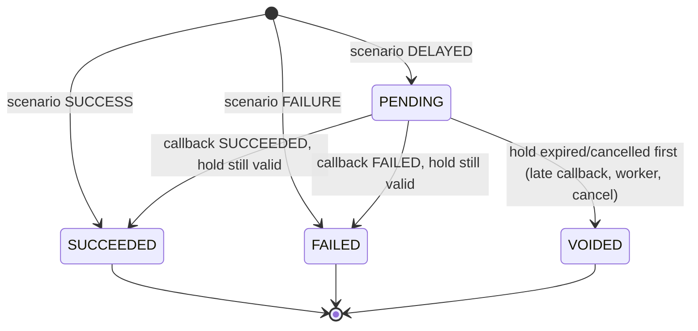

# Concurrency Design — The Last Seat

This is the formal specification of how the backend guarantees that **no seat is ever booked twice**, even with thousands of simultaneous requests, failed and delayed payments, expiring holds and repeated requests. Every rule here is enforced in `app/services/` and proven by tests in `tests/concurrency/` and `tests/integration/`.

---

## 1. The race condition we must prevent

The naive implementation is a *check-then-act* sequence:

```python
# BROKEN — do not do this
active = session.query(Reservation).filter_by(seat_id=s, status="HELD").first()   # CHECK
if active is None:
    session.add(Reservation(seat_id=s, status="HELD"))                            # ACT
    session.commit()
```

With two students A and B clicking "Reserve seat 42" at 6:00:00.000 PM:

| Time | Transaction A | Transaction B |
|---|---|---|
| t1 | `SELECT` → no active hold | |
| t2 | | `SELECT` → no active hold (A has not committed) |
| t3 | `INSERT` HELD | |
| t4 | | `INSERT` HELD |
| t5 | `COMMIT` ✅ | `COMMIT` ✅ → **seat 42 sold twice** |

Python-level locks (`threading.Lock`) do not fix this: production runs several processes (uvicorn `--workers 4`, several containers), and a Python lock only exists inside one process. The fix must live **in the database**, the only component every process shares.

## 2. Defence in depth: three layers

| Layer | Mechanism | What it guarantees |
|---|---|---|
| 1. Serialisation | `SELECT ... FROM seats ... FOR UPDATE` | Only one transaction at a time may make decisions about a given seat. |
| 2. Fresh decisions | `clock_timestamp()` read **after** the lock; lazy expiry under the lock | Decisions use the real current time and the latest committed state. |
| 3. Storage guarantee | Partial unique index `uq_reservations_one_active_per_seat` | Even buggy code that skips layer 1 cannot commit a second active row. |

### 2.1 Layer 1 — the seat row is the mutex

`seats` is immutable inventory (no `is_available` column). We never update it; we only **lock** it:

```sql
SELECT s.id, s.event_id, s.seat_number
FROM seats s
WHERE s.event_id = :event_id AND s.seat_number = :seat_number
FOR UPDATE;
```

`FOR UPDATE` takes a row-level exclusive lock that lasts until `COMMIT`/`ROLLBACK`. A second transaction issuing the same statement **blocks**. Under `READ COMMITTED`, when the lock is granted PostgreSQL re-reads the latest committed version of the row, and every subsequent statement in the waiting transaction takes a fresh snapshot — so B sees A's committed `HELD` row and answers `409`.

Why lock `seats` and not `reservations`? You cannot lock a row that does not exist yet: before the first hold there is no reservation row to lock. The parent `seats` row always exists, so it is a stable mutex for "everything about seat 42".

### 2.2 Layer 2 — time semantics: `clock_timestamp()` not `now()`

`now()` (= `CURRENT_TIMESTAMP`) is frozen at the **start of the transaction**. If B waited 800 ms for A's lock, B's `now()` is 800 ms stale. A hold that expired during that wait would look alive. Rule:

> Acquire the seat lock **first**, then read `t_now := SELECT clock_timestamp()`, and use that single value for every comparison and every timestamp written in the transaction.

A hold is valid **iff** `t_now < expires_at`. At `t_now >= expires_at` it is expired (boundary is exclusive; see `tests/unit/test_units.py::test_effective_status`).

### 2.3 Layer 2b — lazy expiry under the lock

The partial unique index covers `status IN ('HELD','CONFIRMED')`. A hold whose `expires_at` has passed but which nobody has rewritten yet **still occupies the index**. So, still holding the seat lock, the reservation service first runs:

```sql
UPDATE reservations SET status = 'EXPIRED', updated_at = :t_now
WHERE seat_id = :seat_id AND status = 'HELD' AND expires_at <= :t_now;
-- and voids any PENDING payment of those reservations
```

Consequence: **correctness never depends on the background worker**. If the worker is stopped, an expired seat is still bookable the moment someone asks for it (`test_lazy_expiry_lets_new_student_take_stale_seat_without_worker`).

### 2.4 Layer 3 — the partial unique index

```sql
CREATE UNIQUE INDEX uq_reservations_one_active_per_seat
ON reservations (seat_id)
WHERE status IN ('HELD', 'CONFIRMED');
```

Only rows matching the `WHERE` are indexed, so a seat can have unlimited `EXPIRED`/`CANCELLED` history rows but at most one live row. The insert happens inside a `SAVEPOINT` (`session.begin_nested()`); if the index ever fires, the savepoint is rolled back and the request becomes a clean `409 SEAT_UNAVAILABLE` instead of a `500`. `test_partial_unique_index_is_the_last_line_of_defence` inserts directly with raw SQL (bypassing the lock) and proves PostgreSQL rejects the second active row.

A second partial index protects money: `uq_payment_one_succeeded_charge_per_reservation` (at most one `SUCCEEDED` `CHARGE` per reservation).

## 3. Isolation level

We use PostgreSQL's default **`READ COMMITTED`** plus explicit pessimistic locks.

* `SERIALIZABLE` would also prevent the anomaly, but under heavy contention it aborts transactions with serialization failures that every caller would have to retry. For a hot-spot workload (100 students on one seat) pessimistic locking queues them in order and answers each one deterministically on the first try.
* Optimistic concurrency (version columns) has the same retry problem and gives worse latency under contention.

## 4. Global lock order (deadlock prevention)

A deadlock needs a cycle: T1 holds X and wants Y while T2 holds Y and wants X. We make cycles impossible by always acquiring locks in one global order:

```
0. idempotency_records row   (only when an Idempotency-Key header is sent)
1. seats row                 (FOR UPDATE)            <- the per-seat mutex
2. reservations row(s)       (FOR UPDATE / UPDATE)
3. payment_attempts row(s)   (FOR UPDATE / UPDATE / INSERT)
```

When an operation starts from a child id (`/reservations/{id}/confirm`, `/payments/{id}/simulate-callback`), it:

1. reads `seat_id` **without a lock** (safe: a reservation's seat never changes),
2. locks the `seats` row,
3. reads `t_now`,
4. **re-reads** the reservation (and payment) `FOR UPDATE` with `populate_existing=True` so no stale ORM copy is used,
5. only then decides.

Each request locks exactly one seat, so two API requests can never hold two seats in opposite orders. The idempotency row (level 0) is unique per request key, and a transaction waiting on it holds no other lock yet.

The expiry worker may touch many seats; it locks them **in ascending `seats.id` order with `SKIP LOCKED`**, so it never waits on an API request and never creates a cycle. Measured result: zero deadlocks across all concurrency tests and the load test ([load test report](../reports/load_test_report.md)).

## 5. Transaction boundaries per operation

`app/services/idempotency_service.py::run_mutation` owns `BEGIN`/`COMMIT`/`ROLLBACK` for every POST endpoint. Services never commit.

| Operation | Locks (in order) | Writes | Outcome committed? |
|---|---|---|---|
| Hold (`create_reservation`) | [idem] → seat | lazy-expire stale holds; INSERT HELD | 201 yes; 409 yes (lazy expiry kept) |
| Confirm SUCCESS | [idem] → seat → reservation → pending payments | INSERT charge SUCCEEDED; reservation CONFIRMED | 200 yes |
| Confirm FAILURE | same | INSERT charge FAILED | 402 **yes** — failure history must survive |
| Confirm DELAYED | same | INSERT charge PENDING | 202 yes — returns immediately, never sleeps |
| Confirm on expired hold | same | reservation EXPIRED, pending payments VOIDED | 409 yes — frees the seat |
| Callback | [idem] → seat → reservation → payment | payment SUCCEEDED/FAILED/VOIDED; maybe reservation CONFIRMED/EXPIRED | 200/409 yes |
| Cancel HELD | [idem] → seat → reservation | CANCELLED; void pending payments | 200 yes |
| Cancel CONFIRMED | [idem] → seat → reservation → charge | CANCELLED; INSERT REFUND linked to charge | 200 yes |
| Expiry worker batch | seats (ordered, SKIP LOCKED) | EXPIRED; void pending | per batch |

Rule: **expected business outcomes** (`DomainError`: 402/404/409) commit whatever true facts were recorded before them and store the reply for idempotent replay. **Unexpected exceptions** roll back everything, including the idempotency record, so a retry starts clean (`test_crash_mid_confirmation_rolls_back_everything`).

## 6. State machines

### Reservation



Forbidden (and tested): `EXPIRED → *`, `CANCELLED → *`, `CONFIRMED → EXPIRED`. Rows are never deleted.

### Payment attempt



A REFUND is a separate `payment_attempts` row (`payment_type='REFUND'`, `related_payment_id` → original charge).

## 7. The ten invariants

| # | Invariant | How it is proven |
|---|---|---|
| 1 | ≤ 1 `HELD`/`CONFIRMED` reservation per seat | partial unique index + `check_invariants()` after every concurrency test and the load test |
| 2 | Active reservations per event ≤ `total_seats` | follows from 1 + seats belong to one event; SQL check `2_capacity_bound` |
| 3 | Every `CONFIRMED` has exactly one `SUCCEEDED` `CHARGE` | SQL check 3 + `uq_payment_one_succeeded_charge_per_reservation` + `test_10_concurrent_success_confirmations_charge_once` |
| 4 | No confirmation at/after `expires_at` | SQL check 4; `test_confirm_after_expiry_returns_409_and_frees_seat`, `test_boundary_expiry_with_real_clock` |
| 5 | Cancellation frees capacity | `test_cancel_held_frees_seat_for_immediate_reallocation`, `test_cancel_confirmed_records_refund_and_reallocates`, Locust hotspot (7,005 cancel→rebook cycles) |
| 6 | A `FAILED` payment never confirms | SQL check 6; `test_failed_payment_is_recorded_hold_kept_and_retry_succeeds` |
| 7 | Late callback after expiry/cancel → `VOIDED`, never `CONFIRMED` | SQL check 7; `test_late_callback_after_expiry_is_voided_and_never_confirms`, `..._after_seat_reallocated_...`, `test_cancel_with_pending_payment_voids_it...` |
| 8 | Same `(scope, key)` + payload never creates a second row | `tests/integration/test_idempotency.py`, `test_10_identical_requests_same_idempotency_key` |
| 9 | Failures roll back completely | `test_crash_mid_confirmation_rolls_back_everything`; SQL checks 9/9b |
| 10 | No in-memory state | `test_restart_loses_no_state` (engine disposed, fresh app, replay still works) |

`python -m app.cli invariants` runs the SQL checks against `last_seat_db` and exits non-zero on any violation.

## 8. Idempotency protocol (Algorithm 5)

```sql
INSERT INTO idempotency_records (scope, idempotency_key, request_hash, created_at)
VALUES (:scope, :key, :sha256, clock_timestamp())
ON CONFLICT (scope, idempotency_key) DO NOTHING
RETURNING id;

SELECT * FROM idempotency_records
WHERE scope = :scope AND idempotency_key = :key
FOR UPDATE;
```

* Two simultaneous requests with the same key: the second one's `INSERT` blocks on the unique index until the first commits; it then sees the completed record and **replays** the stored status + body (header `Idempotent-Replayed: true`).
* Same key, different payload (SHA-256 of scope + path params + canonical JSON body differs) → `409 IDEMPOTENCY_KEY_PAYLOAD_MISMATCH`, rolled back.
* The record and the business change commit **in the same transaction** — there is no window where one exists without the other.
* Replay returns the **original** status code (201 stays 201). This makes concurrent double-submits indistinguishable from one submit, which is what a client wants.

## 9. The background expiry worker (Algorithm 6)

```sql
-- 1. candidates (no locks)
SELECT seat_id FROM reservations
WHERE status = 'HELD' AND expires_at <= clock_timestamp()
ORDER BY seat_id LIMIT :batch;
-- 2. lock parents, ascending, never wait
SELECT id FROM seats WHERE id = ANY(:candidates) ORDER BY id FOR UPDATE SKIP LOCKED;
-- 3. re-check under the lock and expire
UPDATE reservations SET status='EXPIRED', updated_at=:t_now
WHERE seat_id = ANY(:locked) AND status='HELD' AND expires_at <= :t_now RETURNING id;
UPDATE payment_attempts SET status='VOIDED', ... WHERE reservation_id = ANY(:expired) AND status='PENDING';
COMMIT;  -- then sleep
```

Short transactions, bounded batches, partial index `ix_reservations_expiry_scan` makes step 1 cheap, several workers can run at once (they skip each other's locked seats), and `SIGINT`/`SIGTERM` finish the current cycle before exiting.
