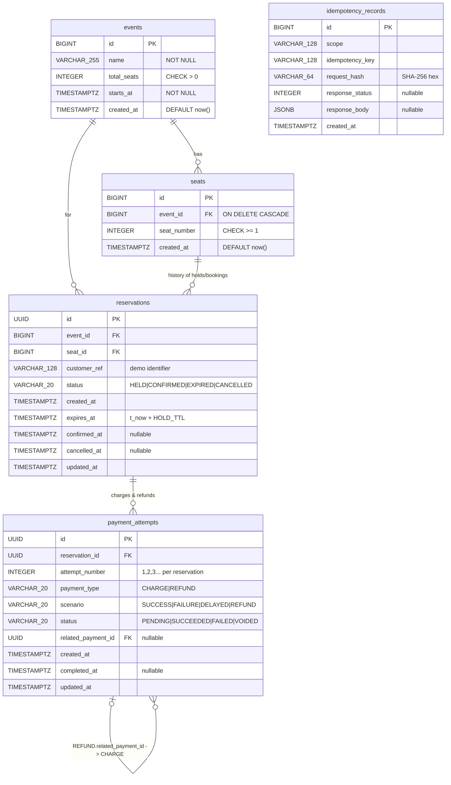

# Entity-Relationship Diagram

`idempotency_records` deliberately has no foreign keys: it stores *responses*, which can describe any resource (or an error).

## Constraints at a glance

| Table | Constraint | Kind | Purpose |
|---|---|---|---|
| events | `ck_events_total_seats_positive` | CHECK | capacity > 0 |
| seats | `uq_seats_event_id_seat_number` | UNIQUE | one seat 42 per event; makes seeding idempotent |
| seats | `ck_seats_seat_number_positive` | CHECK | seat numbers start at 1 |
| reservations | `ck_reservations_status_valid` | CHECK | only the 4 legal states |
| reservations | **`uq_reservations_one_active_per_seat`** | **PARTIAL UNIQUE** `(seat_id) WHERE status IN ('HELD','CONFIRMED')` | **no double booking, ever** |
| payment_attempts | `ck_payment_attempts_*_valid` (3) | CHECK | legal type / scenario / status |
| payment_attempts | `uq_payment_attempts_reservation_id_attempt_number` | UNIQUE | attempt numbers never collide |
| payment_attempts | **`uq_payment_one_succeeded_charge_per_reservation`** | **PARTIAL UNIQUE** `(reservation_id) WHERE payment_type='CHARGE' AND status='SUCCEEDED'` | **no double charging** |
| idempotency_records | `uq_idempotency_records_scope_idempotency_key` | UNIQUE | one record per key per endpoint |

See [database_design.md](database_design.md) for indexes and the reasoning behind each column.
